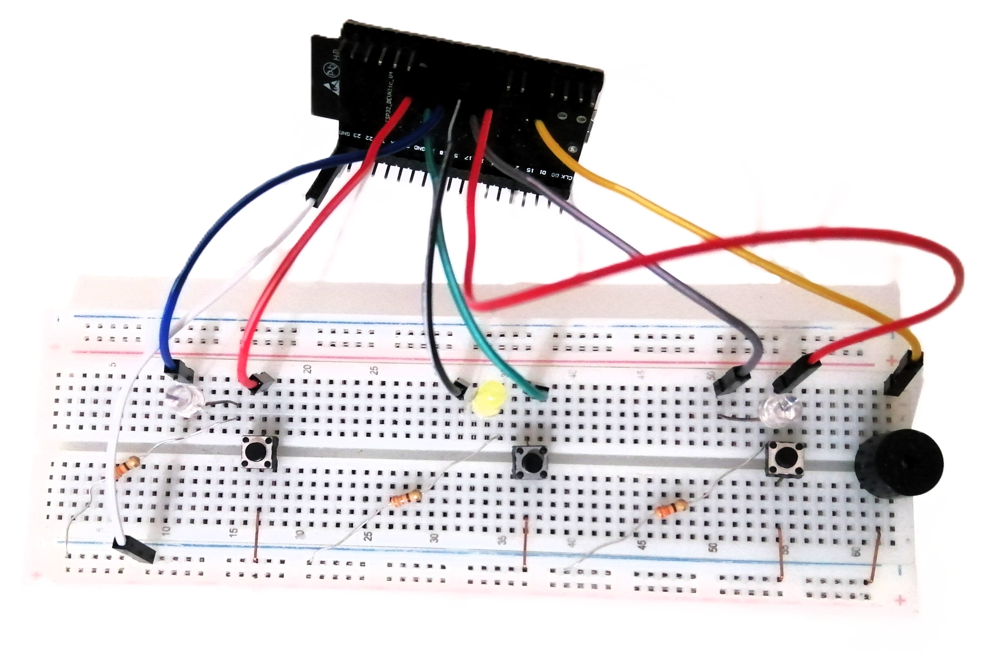
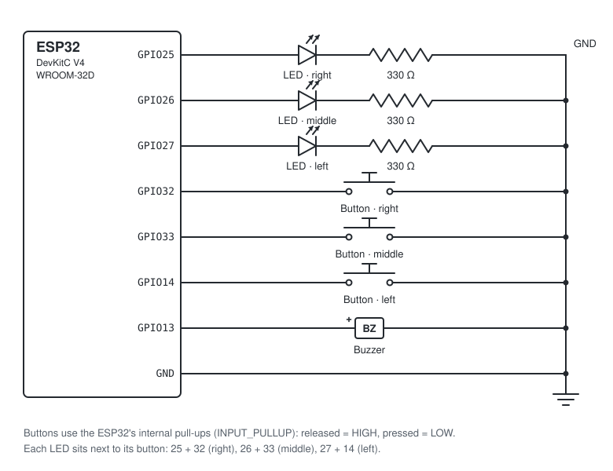

# ESP32 Simon Says

A three-button Simon Says memory game on an ESP32. The LEDs flash a pattern, you repeat it on the buttons, and every round adds one more step.

I built this as a small side project, and a few friends enjoyed playing it, so here is everything you need to build your own: the code, the wiring, and the problems I ran into along the way.



## How it plays

- While it waits, the LEDs chase each other in a loop. Press any button to start.
- Watch the pattern, then press the buttons in the same order. Each round adds one step and plays a little faster.
- A wrong button, or 3 seconds without a press, ends the game. A low buzz sounds, the LED you should have pressed blinks 3 times, then all LEDs blink once for every round you completed.
- The level and score are also printed to the serial monitor at 115200 baud.

## Hardware

| Qty | Part | Notes |
|----:|------|-------|
| 1 | ESP32-DevKitC V4 (ESP32-WROOM-32D) | CP2102 USB-to-serial chip |
| 1 | Breadboard | |
| 3 | 5 mm LEDs | |
| 3 | 330 Ω resistors | one per LED |
| 3 | Push buttons, 2 legs | no resistors needed, the ESP32's internal pull-ups are used |
| 1 | Active buzzer | beeps on plain DC. A passive buzzer also works: set `ACTIVE_BUZZER = false` |
| ~12 | Jumper wires | |

## Wiring



| ESP32 pin | Connects to | Position on my build |
|-----------|-------------|----------------------|
| GPIO 25 | LED 1 long leg. Short leg → 330 Ω → GND | right |
| GPIO 26 | LED 2 long leg. Short leg → 330 Ω → GND | middle |
| GPIO 27 | LED 3 long leg. Short leg → 330 Ω → GND | left |
| GPIO 32 | Button 1. Other leg → GND | right |
| GPIO 33 | Button 2. Other leg → GND | middle |
| GPIO 14 | Button 3. Other leg → GND | left |
| GPIO 13 | Buzzer +. Buzzer − → GND | left |
| GND | Breadboard − rail | |

On the DevKitC V4 all of these pins are on the header that starts with `3V3` and `EN`, so every wire comes off one side of the board.

[`docs/breadboard-layout.svg`](docs/breadboard-layout.svg) shows one example breadboard layout. Any layout works as long as the connections match the table.

## Firmware

| Sketch | What it does |
|--------|--------------|
| [`firmware/SimonTest`](firmware/SimonTest/SimonTest.ino) | Hardware check. Lights each LED with a beep, tells an active buzzer from a passive one, and reports every button press on the serial monitor. Run it first after wiring. |
| [`firmware/SimonSays`](firmware/SimonSays/SimonSays.ino) | The game. |

### Build and upload (Arduino IDE 2)

1. **File → Preferences → Additional boards manager URLs:** add `https://espressif.github.io/arduino-esp32/package_esp32_index.json`
2. **Tools → Board → Boards Manager:** install **esp32 by Espressif Systems**. Both sketches were compiled with version 3.3.12.
3. **Tools → Board:** ESP32 Dev Module. **Tools → Port:** the COM port that appears when the board is plugged in.
4. Open `firmware/SimonTest/SimonTest.ino` and upload it. Open the serial monitor at 115200 baud and press **EN** on the board.
5. Open `firmware/SimonSays/SimonSays.ino` and upload it. This build uses an active buzzer (`ACTIVE_BUZZER = true`). If the test reports a passive buzzer, set it to `false` first.

After a reset, the game prints:

```
Simon Says (ESP32) - game loaded and running
  LEDs:    GPIO 25, 26, 27
  Buttons: GPIO 32, 33, 14
  Buzzer:  GPIO 13 (active)
Press any button to start.
```

### Settings

All settings are at the top of `SimonSays.ino`:

| Setting | Default | Meaning |
|---------|---------|---------|
| `ACTIVE_BUZZER` | `true` | `true` for a buzzer that beeps on plain DC, `false` for a passive one |
| `LED_PINS`, `BUTTON_PINS`, `BUZZER_PIN` | see wiring | change these if you wire to other pins |
| `NOTES` | 523, 659, 784 Hz | one note per LED |
| `MAX_STEPS` | 50 | pattern length that wins the game |
| `TIME_TO_ANSWER` | 3000 ms | time allowed for each press |

## Troubleshooting

These all came up while building this one.

| Symptom | Cause and fix |
|---------|---------------|
| Upload fails with `Could not open COM3 … The semaphore timeout period has expired` | COM3 belonged to the laptop, not the ESP32. Unplug the board and see which port disappears from **Tools → Port**. |
| No new COM port appears. Device Manager shows **CP2102 USB to UART Bridge Controller** under *Other devices* (Code 28) | The USB driver is missing. Install the [Silicon Labs CP210x Universal Windows Driver](https://www.silabs.com/developers/usb-to-uart-bridge-vcp-drivers), then pick the new COM port. |
| One button never registers, even with a known-good button | A faulty breadboard row. Moving the button and its wires to another row fixed it. |
| No game starts, and each button just lights its own LED | The test sketch is still on the board. Upload `SimonSays`. |
| Buzzer stays silent in the game | Check the buzzer on its own: move its + wire from GPIO 13 to 3V3 for a second. A steady beep means an active buzzer, so set `ACTIVE_BUZZER = true`. |

## Acknowledgements

- The game idea comes from the Instructables project [Arduino - Simple Simon Says Game](https://www.instructables.com/Arduino-Simple-Simon-Says-Game/) (2013), rewritten for three buttons on an ESP32.
- Code and documentation were drafted with help from Claude (Anthropic).

## License

[MIT](LICENSE)
